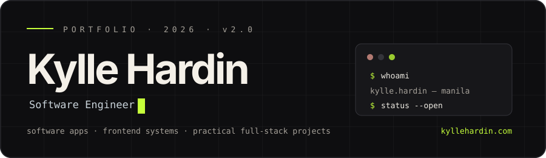
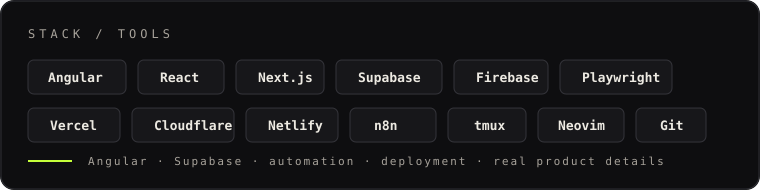

<a href="https://kyllehardin.com">
  
</a>

I build software apps that have to **work beyond the mockup**: real data, auth,
deployment, and the small intricate details that make the product feel solid.

```txt
current   → Frontend Developer Intern @ Exist Software Labs, Inc.
building  → Kathalis web app · Amazing Heartists · portfolio v2
learning  → AI automations
setup     → tmux · Claude Code CLI · Codex CLI · Neovim
```

### Selected work

- **Amazing Heartists** — Angular + Supabase advisory website with public pages, admin CRUD, RLS, Cloudinary uploads, and a Messenger chatbot.
- **BlueLagoon** — Angular hotel booking SPA with route guards, Signals-based booking state, OAuth, and a JSON Server mock API.
- **MockMe** — 3D device mockup tool with media uploads, scene controls, camera controls, and export flows.
- **LigtasMax** — disaster response system for Manila using maps, geofencing, clustering, and responder dashboard workflows.

### Stack



### Reach me

<a href="mailto:mariushardin@gmail.com"></a>
<a href="https://www.linkedin.com/in/kylle-hardin/"></a>
<a href="https://kyllehardin.com"></a>

---

<sub>Manila, Philippines · Open to software engineering roles.</sub>
